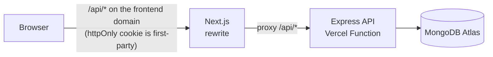

# Doctor Tracker — API

Doctor Tracker is a clinic admin portal for managing doctors, staff accounts, and patients. This repository is the REST API behind it, built with Express 5, TypeScript and MongoDB (Mongoose). Admins manage all records and staff; doctor accounts can manage only their own patients. The API also records a privacy-conscious activity history and provides paginated, searchable, filterable lists.

Frontend: [doctor-tracker-frontend](https://github.com/EzazAsif/doctor-tracker-frontend) (Next.js)

## Live demo

| | |
|---|---|
| API | https://doctor-tracker-backend-eight.vercel.app |
| Health check | https://doctor-tracker-backend-eight.vercel.app/api/health |
| Demo login | `admin@doctortracker.com` / `Admin@12345` |

```bash
curl -X POST https://doctor-tracker-backend-eight.vercel.app/api/auth/login \
  -H "content-type: application/json" \
  -d '{"email":"admin@doctortracker.com","password":"Admin@12345"}'
```

## Getting started

Requirements: Node 20+ and a MongoDB database. A free Atlas cluster works fine.

1. **Clone and install**
   ```bash
   git clone https://github.com/EzazAsif/doctor-tracker-backend.git
   cd doctor-tracker-backend
   npm install
   ```
2. **Configure the environment.** Copy `.env.example` to `.env` and fill it in:
   ```bash
   cp .env.example .env
   ```
   | Variable | Description |
   |---|---|
   | `PORT` | Local port, defaults to `5000` |
   | `NODE_ENV` | `development` or `production` (`production` sets the cookie's `secure` flag) |
   | `MONGODB_URI` | MongoDB connection string, including the database name |
   | `JWT_SECRET` | Long random string, at least 16 characters. The frontend uses the same value |
   | `JWT_EXPIRES_IN` | Token lifetime, e.g. `7d` |
   | `CLIENT_ORIGIN` | Allowed CORS origin(s), comma separated, e.g. `http://localhost:3000` |

   All variables are validated with zod at startup, so a missing or invalid value stops the server with a clear error.
3. **Seed demo data.** This creates the demo admin, 50 doctors across 10 specializations and 8 hospitals, and about 600 patients admitted over the last 14 months. The seed is deterministic, so every run produces the same data.
   ```bash
   npm run seed
   ```
   > This **clears** the activity, users, doctors and patients collections first.
4. **Run it**
   ```bash
   npm run dev        # watch mode on http://localhost:5000
   npm run typecheck  # tsc --noEmit
   npm run recount    # rebuild every doctor's patientCount
   npm run build && npm start
   ```

## Architecture



The browser never calls this API directly. The Next.js app rewrites `/api/*` to the backend, so the auth cookie stays first-party on the frontend domain and needs no third-party cookie or `SameSite=None` workaround. The API still sends proper CORS headers (`CLIENT_ORIGIN` with credentials) for direct clients.

```
src/
  config/       env (zod-validated), cached Mongo connection
  models/       User, Doctor, Patient, Activity + their indexes
  validators/   zod schemas for bodies and query strings
  middleware/   auth, validate, objectId check, rate limit, ensureDb, errors
  routes/       routers, wired together in routes/index.ts
  controllers/  thin HTTP layer: read the request, call a service, send JSON
  services/     business logic and queries
  utils/        ApiError, search/date/pagination helpers
  scripts/      seed
```

Requests flow route → validation → controller → service → model. Every error, including zod errors, Mongoose cast and validation errors, duplicate keys and malformed JSON, is turned into one shape by the central error handler:

```json
{ "error": { "code": "VALIDATION_ERROR", "message": "Invalid input", "details": [{ "path": "email", "message": "Invalid email" }] } }
```

### Endpoints

All routes are under `/api`. Everything except `login` and `health` requires auth, sent either as the `token` cookie or as `Authorization: Bearer <jwt>`. Admins can use all routes. Doctor accounts can use patient routes only, and the API scopes every patient query and mutation to the doctor linked to that account.

| Method | Path | Description |
|---|---|---|
| GET | `/health` | `{ status, db }` |
| POST | `/auth/login` | Sets the httpOnly `token` cookie. Rate limited to 10 failed attempts per 15 min per IP |
| POST | `/auth/logout` | Clears the cookie |
| GET | `/auth/me` | Current user |
| GET / POST | `/users` | Admin only: list accounts or create an admin/doctor account. Doctor account email must match an existing doctor record |
| PATCH | `/users/:id` | Admin only: activate or deactivate an account; the final active admin and the signed-in account cannot be deactivated |
| GET | `/activity` | Admin only: paginated activity events, newest first |
| GET | `/doctors` | `search`, `specialization`, `hospital`, `from`, `to`, `sort`, `page`, `limit` |
| GET | `/doctors/options` | Distinct specializations and hospitals for the filter dropdowns |
| GET | `/doctors/lookup?search=` | Up to 20 `{ _id, name, specialization }` for doctor pickers |
| POST | `/doctors` | Create a doctor (409 if the email is taken) |
| GET / PATCH / DELETE | `/doctors/:id` | Read, partially update, or delete. Delete cascades to the doctor's patients |
| GET | `/doctors/:id/patients` | A doctor's patients: `search`, `condition`, `status`, `from`, `to` |
| POST | `/doctors/:id/patients` | Add a patient to this doctor |
| DELETE | `/doctors/:id/patients/:patientId` | 404 if the patient isn't this doctor's |
| GET | `/patients` | Admin: `search`, `condition`, `status`, `gender`, `doctor`, `from`, `to`, `sort`, `page`, `limit`; doctors always receive their own patients |
| POST | `/patients` | Admin creates with a `doctor`; doctors create under their linked doctor record |
| GET / PATCH / DELETE | `/patients/:id` | Admin may move a patient; doctors can change only records assigned to them |
| GET | `/dashboard/stats?from=&to=` | Totals and breakdowns. Defaults to the last 12 months |

Lists return `{ data: [...], meta: { page, limit, total, totalPages } }`. `from` and `to` are inclusive `YYYY-MM-DD` dates (UTC), and `to` covers the whole day.

## Technical decisions

### 1. Denormalized `patientCount` instead of `$lookup` on every list request

The doctor list shows each doctor's patient count and can **sort by it**. There are two ways to get that number:

- **Compute it per request** with a `$lookup` (or `$group`) on `patients`. This is always correct, but the cost grows with the patients collection, not with the page size. Worse, sorting by a computed count means MongoDB has to count patients for *every* doctor that matches the filter before it can sort, skip and limit. A 10-row page then costs a pass over all matching doctors and all of their patients, and no index can help with a sort on a computed field.
- **Store it on the doctor** (`patientCount`) and keep it up to date on writes. The list becomes a plain indexed `find` with `sort({ patientCount: -1 })`, served by the `{ patientCount: -1 }` index, and the cost depends only on the page size.

The app reads far more often than it writes, so I chose the second option. The trade-off is keeping the counter correct:

- It only changes in the patient service: `+1` on create, `-1` on delete, and `-1`/`+1` when a patient moves to another doctor.
- **No multi-document transactions.** The API runs as stateless serverless functions, so each request is a short sequence of single-document writes that are atomic on their own, done in an order that is safe if the function dies partway:
  - **Create:** insert the patient first, then `$inc` the doctor by `+1`. The counter is only bumped for a patient that was actually saved.
  - **Delete:** `findOneAndDelete`, then `$inc -1` only if a document was really deleted. A double delete or a race returns 404 and leaves the count alone.
  - **Move to another doctor:** `findByIdAndUpdate` returns the *previous* document, so the old doctor is read atomically with the update. After the update succeeds, `-1` on the old doctor and `+1` on the new one run in parallel.
  - **Delete a doctor:** `deleteMany` their patients first, then delete the doctor. If it fails halfway, the doctor still exists and the request can simply be retried.
- Clients can't set it: the zod schemas don't include `patientCount`, so it is stripped from request bodies.
- The dashboard reuses it for the per-specialization patient totals, so that query needs no join either.

The worst case is a crash between the patient write and the `$inc`, which leaves a count off by one. For that there is a repair tool:

```bash
npm run recount
```

It rebuilds every `patientCount` with one `$group` aggregation over `patients` plus one `bulkWrite`, and sets doctors with no patients back to 0. The seed script uses the same function. It is idempotent, so it is safe to run at any time or on a schedule.

### 2. Indexing strategy for search, filtering and pagination

Each index matches a query the UI actually runs, following the **equality → sort → range** rule:

| Collection | Index | Serves |
|---|---|---|
| doctors | `{ email: 1 }` unique | Duplicate email check (409 CONFLICT) |
| doctors | `{ createdAt: -1 }` | Default list order and the `from`/`to` filter |
| doctors | `{ specialization: 1, createdAt: -1 }` | "Cardiology, newest first": equality then sort, no in-memory sort |
| doctors | `{ hospital: 1 }`, `{ name: 1 }`, `{ patientCount: -1 }` | Hospital filter, A–Z sort and doctor picker, "most patients" sort |
| patients | `{ doctor: 1, admissionDate: -1 }` | A doctor's patient tab (newest first), cascade delete, moves |
| patients | `{ condition: 1, admissionDate: -1 }` | Condition filter with the default sort |
| patients | `{ admissionDate: -1 }` | Default sort, date range, and the dashboard's `$match` |
| patients | `{ status: 1 }`, `{ name: 1 }` | Status filter, A–Z sort |
| users | `{ email: 1 }` unique | Login |
| users | `{ doctor: 1 }` unique when linked | One login per doctor record |
| activity | `{ createdAt: -1, _id: -1 }` | Newest-first history |

Other choices on the query side:

- **Page and total in parallel.** `find().skip().limit()` and `countDocuments()` run together in `Promise.all`, so a list costs one round trip instead of two.
- **`.lean()` and projections.** List queries return plain objects and select only the fields the UI shows, which skips Mongoose document hydration.
- **Stable pagination.** Every sort adds `_id` as a tie-breaker, so rows with the same `createdAt` or `name` can't show up on two pages.
- **Safe search.** `search` is a case-insensitive partial match, and user input is regex-escaped first (`utils/query.ts`), so `.*(` is searched for literally instead of breaking the query or being used for ReDoS. A leading-wildcard regex can't use a B-tree index for the match itself. At this scale (hundreds to thousands of records per admin) that is fine, and the filter and sort parts of the query still use their indexes. If the data grew to millions of records, the next step would be an Atlas Search index (or a `$text` index for whole-word search). The service layer is the only place that would need to change.
- **Dashboard.** A single `$match` on `admissionDate` (indexed) followed by one `$facet` computes the in-range count, monthly series, top 10 doctors, and condition, status and gender breakdowns in one pass. The doctor-side stats use their own `$facet`. Doctor names are fetched only for the top 10 ids, all-time totals use `estimatedDocumentCount()` (collection metadata, no scan), and months with no data are filled with `0` in code so the charts have no gaps.
- **Pagination limit** is capped at 100 and validated, like every other query parameter.

### Other notes

- **Auth and roles.** The JWT (HS256) lives in an `httpOnly`, `SameSite=Lax` cookie that is `Secure` in production. Each request reloads the active user and role from MongoDB, so deactivation takes effect without waiting for token expiry. Admin-only routes are enforced in the API; doctor patient queries are scoped by the linked doctor ID. Login compares against a dummy hash when the email is unknown.
- **Activity history.** Successful doctor, patient, import and staff changes create an event with the actor ID and role, resource ID, action, timestamp, changed field names, and import counts. It does not copy patient field values or notes. Only admins can read the paginated history.
- **Doctor account linking.** An admin creates a doctor login using the same email as an existing doctor record. The unique optional user-to-doctor link prevents a doctor record from getting multiple accounts. Deactivation blocks new logins and invalidates existing API sessions.
- **Serverless-friendly Mongo.** The connection promise is cached on `globalThis`, so warm invocations reuse it and concurrent cold requests share one `connect()`. A failed connection isn't cached, so the next request retries.
- **Rate limiting** uses the in-memory store, which is per instance. A shared store (Redis or Upstash) would be the next step if this ran on many instances.
- **Hardening.** helmet, compression, a 100 kb JSON body limit, `trust proxy` for correct client IPs behind Vercel, and stack traces only outside production.

## Deployment

Deployed on Vercel as an Express app with zero config. `src/index.ts` default-exports the app and only calls `app.listen` when it isn't running on Vercel. Environment variables are set in the Vercel project: `MONGODB_URI`, `JWT_SECRET`, `JWT_EXPIRES_IN`, `NODE_ENV=production`, `CLIENT_ORIGIN`.

```bash
vercel --prod
```
